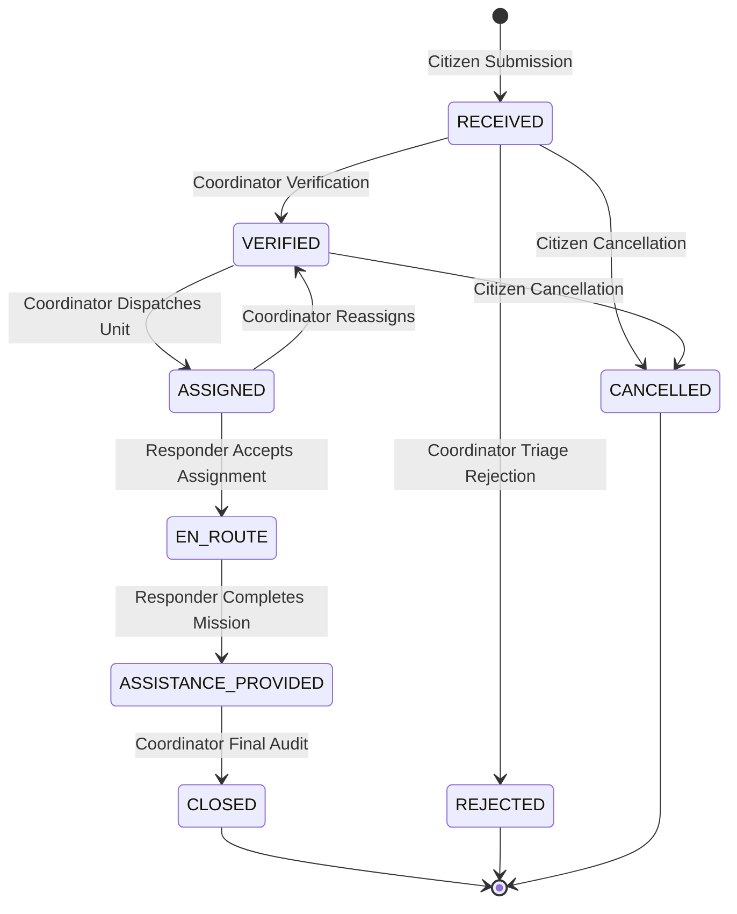

# RESQNET System Architecture Documentation

**Problem ID**: HACK-P437  
**Platform**: RESQNET — Intelligent Disaster Response & Coordination Platform  
**Status**: Prototype Demonstration System  

---

## 1. Executive Summary

RESQNET is an intelligent disaster assistance triage and operational coordination platform designed for simulated emergency events (floods, storms, fires, earthquakes, and landslides). The platform centralizes multi-channel citizen requests, calculates deterministic explainable priority scores (0–100), governs responder dispatch against team capacity limits, maintains an immutable status workflow audit ledger, and supports offline-resilient submission via browser IndexedDB persistence.

> **CRITICAL OPERATIONAL NOTICE**: RESQNET is an incident coordination prototype. It is not an official emergency dispatch service. Requests submitted here are not automatically transmitted to government or municipal emergency services.

---

## 2. High-Level Architecture

The platform enforces a clean decoupling between the client presentation layer and backend API services:

```mermaid
graph TD
    subgraph Client["Frontend Client (React 19 + TypeScript + Vite)"]
        UI[Operational UI & Design System]
        AuthCtx[Auth Context & Role Guards]
        OfflineMgr[IndexedDB Offline Queue & Idempotency Manager]
        ServiceWorker[Service Worker App-Shell Cache]
        LeafletMap[Interactive Disaster Map (OpenStreetMap)]
    end

    subgraph Server["Backend API (FastAPI + Python 3.11)"]
        APIRouters[API Routers: Auth, Requests, Responders, Dashboard, Sync]
        Security[Bcrypt & JWT Role Authorizer]
        PriorityEngine[Deterministic Explainable Priority Engine]
        WorkflowSM[Status State Machine & Workload Governor]
        AuditService[Audit Log & Notification Generator]
    end

    subgraph Storage["Data Persistence"]
        SQLite[(SQLAlchemy ORM / SQLite / PostgreSQL)]
    end

    UI --> AuthCtx
    UI --> OfflineMgr
    UI --> LeafletMap
    OfflineMgr -.->|Idempotent Batch Sync| APIRouters
    UI -->|REST API over HTTP| APIRouters
    APIRouters --> Security
    APIRouters --> PriorityEngine
    APIRouters --> WorkflowSM
    WorkflowSM --> AuditService
    APIRouters --> SQLite
```

---

## 3. Technology Stack & Component Responsibilities

### Frontend
- **Framework**: React 19, Vite, TypeScript
- **Styling**: Tailwind CSS with tailored emergency operations palette:
  - Deep Navy: `#14243A`
  - Primary Blue: `#2563EB`
  - Emergency Red: `#DC2626`
  - Warning Amber: `#D97706`
  - Success Green: `#15803D`
  - Neutral Canvas: `#F4F7FB`
- **Routing**: React Router DOM v7 with role-based `ProtectedRoute` guards
- **Data Visualization**: Recharts (status distribution, incident hazard types, priority bands)
- **Geospatial Mapping**: Leaflet and React-Leaflet with OpenStreetMap tiles and custom SVG priority-colored pulse markers
- **Offline Resilience**:
  - `idb`: IndexedDB wrapper for pending request storage and queue management
  - Service Worker: Pre-caches critical app-shell assets (`/`, `/index.html`, `/favicon.svg`)
  - Automatic `window.navigator.onLine` connectivity detection with manual and automatic retry synchronization

### Backend
- **Framework**: Python 3.11 with FastAPI (async ASGI)
- **Database Engine**: SQLAlchemy 2.0 ORM with SQLite (environment-configurable to PostgreSQL via `DATABASE_URL`)
- **Data Validation**: Pydantic v2 schemas and validation models
- **Security & Cryptography**:
  - `bcrypt` for secure salted password hashing
  - `pyjwt` for HMAC-SHA256 signed JWT session tokens with role claims
- **Testing**: `pytest` and `httpx` with in-memory SQLite isolation

---

## 4. Database Schema Design

The relational database schema is structured into 8 core models:

1. **`User`**: Primary authentication entity with `email`, `hashed_password`, `role` (`CITIZEN`, `COORDINATOR`, `RESPONDER`), and active flags.
2. **`ResponderProfile`**: Specialized profile linked 1-to-1 to a Responder User:
   - `team`: Call sign or squad designation (e.g., *Rapid Search & Rescue Alpha*)
   - `supported_categories`: JSON array of emergency capabilities
   - `availability`: `AVAILABLE`, `BUSY`, or `OFF_DUTY`
   - `max_concurrent_assignments`: Workload limit (default 3)
   - `current_assignment_count`: Real-time active assignment count
   - `latitude`, `longitude`: Field unit coordinates
3. **`AssistanceRequest`**: Core incident record:
   - `tracking_code`: Human-friendly unique identifier (e.g., `REQ-0017`)
   - Content: `title`, `incident_type`, `description`, `location_name`, `latitude`, `longitude`
   - Numbers: `people_affected`, `people_urgent`
   - Indicators: `is_immediate_threat`, `is_medical_emergency`, `is_vulnerable_present`, `is_essential_unavailable`
   - Status: State machine status string
   - Priority: `calculated_priority_score` (0–100), `priority_band`, `priority_factors_json`, `priority_explanation`
   - Administrative Overrides: `priority_override_score`, `priority_override_band`, `priority_override_reason`, `priority_override_by_user_id`
   - Verification: `verification_notes`, `verified_by_user_id`, `verified_at`
   - Offline Tracking: `idempotency_key`, `client_local_id`
4. **`Assignment`**: Dispatches between a request and a responder profile, recording assignment status, timestamps, notes, and override reasons.
5. **`StatusHistory`**: Chronological audit trail of every status transition with actor and explanation.
6. **`Notification`**: Real in-app alerts generated by system events.
7. **`AuditLog`**: Compliance ledger recording all administrative priority overrides, assignments, and verification actions.
8. **`SynchronizationRecord`**: Idempotency ledger preventing duplicate submissions during offline reconnection retries.

---

## 5. Explainable Priority Engine

The priority engine is deterministic, mathematical, and fully transparent. It calculates an integer score between 0 and 100 based on documented rules:

$$\text{Priority Score} = \min\left(100, \sum \text{Factor Points}\right)$$

| Factor Key | Factor Name | Condition | Points Added |
| :--- | :--- | :--- | :--- |
| `immediate_threat` | Immediate Threat to Life | Active structural collapse, rising water, fire wall | **+35** |
| `medical_emergency` | Urgent Medical Emergency | Severe injury, acute trauma, oxygen/dialysis failure | **+25** |
| `multiple_urgent_people` | Multiple People in Immediate Need | $\ge 2$ people marked as urgent | **+15** |
| `single_urgent_person` | Individual in Urgent Need | Exactly 1 person marked as urgent | **+8** |
| `vulnerable_present` | Vulnerable Individuals Present | Infants, elderly, disabled, mobility-impaired | **+10** |
| `essential_unavailable` | Essential Resources Unavailable | Lacks clean drinking water, heating, or vital meds | **+10** |
| `waiting_time` | Waiting Time Adjustment | +1 point per elapsed hour in queue | **Up to +5** |

### Priority Bands
- **CRITICAL**: 75 – 100
- **HIGH**: 50 – 74
- **MEDIUM**: 25 – 49
- **LOW**: 0 – 24

### Ethical Guardrails
- Protected demographic characteristics (race, gender, religion) are never collected or scored.
- Vulnerability indicators function solely to provide additional life support, never to deprioritize a case.
- Coordinators can review and administratively override scores with a documented audit explanation.

---

## 6. Incident Status State Machine

Request progression follows strict role-governed state transitions:



---

## 7. Offline-First Synchronization & Idempotency

When connectivity fails:
1. The request form catches network errors and stores the complete JSON payload into IndexedDB (`resqnet_offline_v1` -> `pending_requests`).
2. An `idempotency_key` (UUID v4) and local tracking ID are assigned.
3. The confirmation screen notifies the user that the request is queued locally.
4. When `window.onLine` fires (or user clicks "Sync Now"), requests are batched to `POST /api/sync/requests`.
5. The backend validates whether each `idempotency_key` has already been recorded in `synchronization_records`. If yes, it returns `EXISTING_IDEMPOTENT` and the existing server tracking code without creating duplicate records.

---

## 8. Cybersecurity & Governance Controls

1. **Authentication**: Bcrypt salted password hashes (cost factor 12) + signed JWT tokens. Plaintext passwords are never logged or stored.
2. **Server-Side Authorization**: Every API route enforces role dependencies (`require_coordinator`, `require_responder`). Frontend button hiding is never treated as security.
3. **Workload Governance**: Dispatching to responders at max capacity is blocked unless an explicit coordinator override reason is provided.
4. **Audit Trail**: Every priority override and status change logs the responsible user ID, previous values, new values, rationale, and timestamp.
